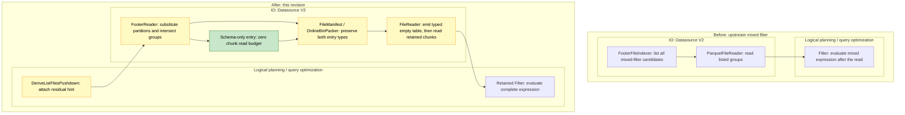

# [Data] Prune mixed partition/data filters during Parquet listing

This revision moves mixed partition/data pruning into Parquet listing, following [Aarrya’s suggestion](https://github.com/ray-project/ray/pull/67855#issuecomment-6671027378). For the query in [#67567](https://github.com/ray-project/ray/issues/67567), read workers receive only the row groups that may match, while the complete row filter stays in place.

Before this PR, a mixed filter such as `(year == "2023") | (x < 1000)` leaves all row groups to be read. The original PR made the pruning decision inside the reader. This revision makes it while reading footers: substitute each file’s partition values, then intersect the selected groups with those allowed by any existing pushed data filter. For that query, files under `year=2023` keep all groups; for other years, the footer can exclude groups using `x < 1000`.

Subsystems: **Logical planning / query optimization** and **IO** (Datasource V2 listing, manifests, packing and readers).



## Changes after review

The partition substitution now uses Ray’s existing column-substitution visitor in a common helper. The Parquet adapter checks the partition values and file schema. An existing pushed data filter no longer disables the optimization; both that filter and the complete residual filter remain in place. The supported expressions now include nested AND/OR/NOT, null checks and bounded literal IN, rather than only the original comparison patterns.

Preserving an empty result’s schema needed a separate change. Keeping a data group just for its schema still caused a read. Listing now emits at most one schema-only manifest entry per shard with a verified layout, alongside any surviving data chunks. The paired reader uses its normal partition-column handling and projection to emit a typed empty table before opening data files. It does this even when data chunks follow, so the schema also survives when filtering returns no rows at execution time. The entry retains the real source file size, has a zero chunk read budget, and is not an exact residual-filter count.

Aarrya, since [#67037](https://github.com/ray-project/ray/pull/67037) also changes the shared manifest/count interfaces, would you put this reader instruction in the manifest? It avoids changing the general executor, but adds an entry that represents schema rather than data to scan. I would like to settle that choice before extending source support.

## Scope and error behavior

The new path is limited to a root `Filter → ReadFiles → ListFiles` query using built-in local Hive Parquet. Sharing substitution code does not establish how another source derives partition values or produces its output schema.

<details>
<summary>Supported expressions and fallback cases</summary>

- Signed `int8`, `int16`, `int32` and `int64` comparisons, with literals that fit the field width. Column-to-column comparisons must resolve through partition substitution; if two columns remain, the hint is declined.
- String/bool equality and inequality, leaf null checks, and nested AND/OR/NOT. Every part of the residual expression must be supported.
- Literal IN lists of 1–256 homogeneous, non-null values, with int64, bool or string input. Narrow-integer IN is not supported.
- Float64 is allowed as an unreferenced payload column. Floating-point operands, arithmetic and UDFs in the residual expression fall back to the existing path.
- Remote/custom filesystems, scanner/indexer subclasses and non-Hive partitions fall back. The ordinary retry wrapper around the built-in local filesystem is supported.
- Unsupported or nested/extension types, schema/field metadata, synthesized columns and custom Parquet format options fall back. Downstream maps, count/limit plans, ordered or shuffled reads, checkpointing and tolerated block errors also use the existing path.

Missing statistics can keep every group, and IN pruning depends on the Arrow version. This does not include [#67943](https://github.com/ray-project/ray/pull/67943)’s derived arithmetic or prefix predicates.

</details>

Required footer reads still happen, and errors on the read path that actually runs propagate normally. Pruned groups are not read or evaluated just to reproduce an error: a corrupt page or a division-by-zero expression confined to those groups may no longer raise.

A read task containing only schema-only entries returns without constructing the data scanner. Options normally checked at that step, such as an invalid `batch_size`, may therefore go unchecked when no data needs to be read. There is no separate validation pass and no `batch_size` gate on the listing hint. If data chunks remain, the ordinary reader path still runs. This is a change from the original PR’s decision to disable pruning whenever a data filter was already pushed; it does not promise identical errors for work that pruning removes.

## Tests

Thanks, [Jadiouo](https://github.com/ray-project/ray/pull/67855#pullrequestreview-5796666582), for checking the base too. The old e2e test could pass while reading everything. The tests now observe real read workers, use pruning-disabled controls, and check consumed groups, output and schema. The planning regressions are in the listing rule’s test module, before its main guard.

The original issue’s regression compares the complete `(x, year, month)` multiset in both arms, including duplicate counts, and checks the schema. On PyArrow 17.0.0 and 23.0.1, it returned the same 5,000 fully checked rows while consumption fell from 160 to 25 row groups and from 32 to five data files. Footer reads still happen; these are data-consumption counts, not total opens or bytes.

The focused checks passed **306 tests with one expected failure on each Arrow version**: 229 unit tests, 21 schema-only end-to-end tests, and 56 footer-reader/chunking tests. The expected failure is the known case where partition pruning removes every file before footer listing, so no schema entry reaches the reader. Jadiouo’s original 20-query script has not been rerun as a set.

Those runs used `eb672700` plus the final test-only oracle update, Python 3.11.18, matching Ray Core `891a5a89`, and usage statistics disabled. The final integrated commit `17bbe597` has identical changed source/test files; the only difference among the 837 Data files is an unrelated upstream `llm.py` documentation line. The 306-test selection has not been rerun on that integration. Its performance experiment below used matching `aa00fdbb` Core. These are local checks, not a full upstream CI pass.

<details>
<summary>Test commands and source identity</summary>

Both Arrow environments ran these commands from `/workspace`, with `python` referring to `/tmp/check-venv/bin/python`. The harness set `PYTHONPATH=/harness`, `PYTEST_PLUGINS=identity_guard,usage_state`, `PYTHONDONTWRITEBYTECODE=1` and `RAY_USAGE_STATS_ENABLED=0`. The plugins check the loaded source and runtime; copying the pytest lines alone does not reproduce that identity audit.

```bash
python -m pytest -v -ra -p no:cacheprovider \
  --basetemp=/out/pytest-original --junitxml=/out/original.xml \
  'python/ray/data/tests/datasource_v2/test_schema_only_manifest.py::test_empty_output_schema_and_actual_reads[original]'

python -m pytest -v -ra -p no:cacheprovider \
  --basetemp=/out/pytest-unit --junitxml=/out/unit.xml \
  python/ray/data/tests/unit/datasource_v2/test_listing_pruning_context.py \
  python/ray/data/tests/unit/datasource_v2/test_listing_integration.py \
  python/ray/data/tests/unit/datasource_v2/test_schema_only_manifest.py \
  python/ray/data/tests/unit/datasource_v2/test_file_reader_layout.py \
  python/ray/data/tests/unit/datasource_v2/test_listing_read_audit.py \
  python/ray/data/tests/unit/datasource_v2/test_arrow_file_scanner.py \
  python/ray/data/tests/unit/datasource_v2/test_online_bin_packer.py \
  python/ray/data/tests/unit/datasource_v2/test_chunk_metadata.py \
  python/ray/data/tests/unit/datasource_v2/test_derive_list_files_pushdown.py

python -m pytest -v -ra -p no:cacheprovider \
  --basetemp=/out/pytest-worker --junitxml=/out/worker.xml \
  python/ray/data/tests/datasource_v2/test_schema_only_manifest.py \
  python/ray/data/tests/datasource_v2/test_footer_reader.py \
  python/ray/data/tests/datasource_v2/test_footer_chunking.py -k 'not original'
```

The stages returned 1 passed, 229 passed, and 76 passed / 1 xfailed / 1 deselected. The original-issue case was deselected only in the last stage because it ran separately first. The schema-only file accounts for 21 passed / 1 xfailed in total; the other 56 tests in the last stage are footer-related. All stages exited successfully. Black, Ruff, import ordering and Pyrefly passed on the oracle-only update.

- Test-only patch on `eb6727009e5305106f45607cffd549e4ca86e512`: SHA-256 `3a57d79a8d4593146936a828ef5c68a830c870993bb12984fa03017e5995e6bb`.
- Tested 837-file source manifest: `7337a1424907d06858689c5955814161710b34060d7ff669875edb6a6929bdb7`.
- Final integration: `17bbe5978dfb326746fca975be4a3abb9277a6b7`, based on upstream `aa00fdbb6c64a358f19e2f523068d612b19874de`.
- Final integrated 837-file manifest: `958afc6d778eee15f1ef0aa733d5f003bb7320271ca8e26d06a3dff256b0bd6b`.

</details>

## Performance

All timings here are new measurements of final commit `17bbe597` against clean upstream `aa00fdbb`, using matching Core and PyArrow 23.0.1. The selective fixture occupies **3,735,281,660 bytes (3.735 GB)**: 55 Hive-partitioned files, each with 64 groups of 1,024 rows and a 1,024-byte payload per row. The filter `(p == -1) | (x >= 57344)` keeps the final eight groups in each file. The payload is a string of 1,024 ASCII bytes; files use no compression or dictionary encoding, and only `x` has statistics. Separate diagnostics checked the complete content, schema and duplicate counts of all 450,560 output rows, including every payload byte. Consumption fell from 3,520 to 440 groups; both versions still consumed data from all 55 files.

The small all-kept control uses `(year == "2023") | (x >= 0)` and occupies 205,457 bytes in 32 files with five groups each. Both versions consumed all 160 groups and returned the same 32,000 fully checked rows; the candidate’s hint was active.

Each case used four pairs, alternating upstream → revision and revision → upstream. The selective query took 8.50–27.25% less time, with a median paired reduction of 14.10% (median upstream/revision ratio 1.168×). The small control was slower in **all four pairs**, by 86.9–335.6 ms or 2.35–9.60%, with a median increase of 5.91%.

<details>
<summary>All formal timing pairs and measurement conditions</summary>

Selective case:

| Pair order | Upstream | This revision | Query-time change |
|---|---:|---:|---:|
| Upstream → revision | 9.0607 s | 6.5920 s | −27.25% |
| Revision → upstream | 8.7438 s | 7.0726 s | −19.11% |
| Upstream → revision | 6.7789 s | 6.2025 s | −8.50% |
| Revision → upstream | 6.9334 s | 6.3033 s | −9.09% |

Small all-kept control:

| Pair order | Upstream | This revision | Query-time change |
|---|---:|---:|---:|
| Upstream → revision | 3.7024 s | 3.7893 s | +86.9 ms (+2.35%) |
| Revision → upstream | 3.5155 s | 3.7555 s | +240.1 ms (+6.83%) |
| Upstream → revision | 3.4964 s | 3.8320 s | +335.6 ms (+9.60%) |
| Revision → upstream | 3.5988 s | 3.7785 s | +179.8 ms (+4.99%) |

The machine was a 32 GiB Mac running Linux ARM64 Docker, Python 3.11.18 and PyArrow 23.0.1. The container had four CPUs and a 5 GiB memory limit. Ray used two CPUs, a 1 GiB object store and a 512 MiB Data soft budget; spilling and usage statistics were disabled, with unordered local-filesystem reads.

Every run used a fresh Ray instance and an ordinary full forward pre-read before Ray startup. The query timer started before Dataset/filter construction and ended after `iter_batches(batch_size=4096, batch_format="pyarrow", prefetch_batches=0)` finished. It included listing, reading, filtering, transfer and row-count/schema/null checks. Startup/shutdown, pre-reading, source hashing and stats extraction were excluded; startup was recorded separately at 2.14–3.42 s. Full payload hashing and read observers ran only in four diagnostic runs before the 16 formal samples. No formal samples failed or were excluded.

</details>

Caches were not cleared, and the pre-read does not establish that the fixture stayed in memory. The container reached its 5 GiB limit and experienced memory reclaim, without an OOM or observed spill. Upstream selective timings ranged from 6.779 to 9.061 s. Four pairs under these conditions do not establish a stable regression bound or performance on cold storage or remote filesystems. Total opens and exact I/O bytes were not measured.

This continues #67567’s proposed per-file substitution in the existing PR. It is distinct from #67943’s derived predicates and #67037’s manifest/count changes; their combined behavior has not been tested.

AI assistance was used.
