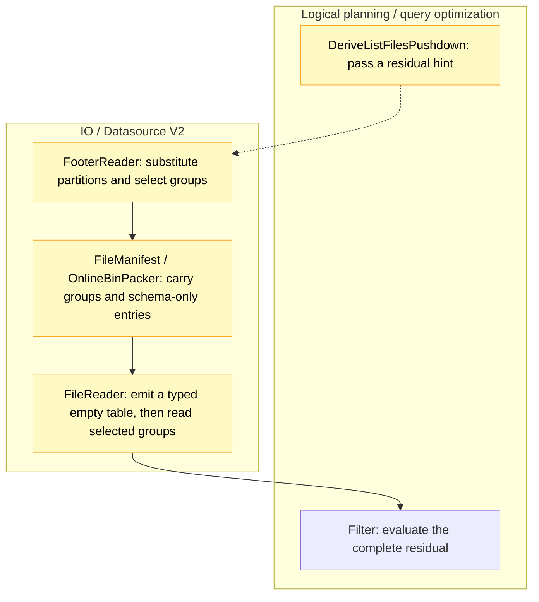

# [Data] Prune mixed partition/data filters during Parquet listing

## Description

This PR lets Datasource V2 use a file's partition values to prune Parquet row groups during listing. It addresses the full scan in [#67567](https://github.com/ray-project/ray/issues/67567), while keeping the full filter that determines which rows are returned.

**Before:** for `(year == "2023") | (x < 1000)`, treating either half as a required condition would drop rows that match the other half. Files outside 2023 may contain small `x` values, and rows in 2023 match regardless of `x`. Ray therefore keeps the mixed OR above the read and scans every candidate row group.

**After:** listing substitutes the year from each file's path. The expression becomes true for files under `year=2023` and `x < 1000` for the other files. Parquet footer statistics can then exclude groups that cannot match, before they become read tasks. Required footer reads still happen.

## How it works

Following [Aarrya's review](https://github.com/ray-project/ray/pull/67855#issuecomment-6671027378), this revision moves the decision from the reader to footer listing. It intersects the groups selected by the per-file expression with those allowed by any existing pushed data filter. Both the pushed filter and the complete residual filter stay in place.

Partition substitution lives in a common helper and reuses Ray's column-substitution visitor. The Parquet adapter checks that the substituted values and physical schema match what its reader would return. Other indexers can opt in through `FileIndexer.with_residual_pruning`, but must establish the same agreement with their reader and implement pruning for their own read units. They can reuse the shared empty-table path where their layout permits it.

For example, ORC already shares the Arrow reader and partition parser, but [does not implement native stripe pruning](https://github.com/m4ru1/ray/blob/17bbe5978dfb326746fca975be4a3abb9277a6b7/python/ray/data/_internal/datasource_v2/formats/orc/orc_file_reader.py#L34-L40). MCAP [keeps a message's own `topic`](https://github.com/m4ru1/ray/blob/17bbe5978dfb326746fca975be4a3abb9277a6b7/python/ray/data/_internal/datasource_v2/formats/mcap/mcap_reader.py#L247-L272) when it conflicts with a `topic=.../` path, so parsing the path alone does not justify substituting that value. This PR enables only the built-in local Hive Parquet path.

Subsystems: **Logical planning / query optimization** and **IO**.



### Keeping the schema when nothing matches

Dropping every data group can also lose the empty result's schema. Keeping one group just to recover that schema would leave an unnecessary read.

Instead, listing emits at most one schema-only manifest entry per shard after verifying the reader layout. The reader uses its normal partition-column handling and projection to emit a typed empty table without opening that entry's data file. It does this even when other groups survive, so the schema also remains available if row filtering later removes every row. The entry has a zero read budget, retains the source file's actual size, and is not an exact count of the residual filter's result.

Aarrya, is the manifest the right place for this instruction? It avoids changing the general executor, but extends the shared interface also touched by [#67037](https://github.com/ray-project/ray/pull/67037).

### Limits

The hint is optional. If an expression, source or layout is unsupported, the existing read path and filters remain in use. The residual must reference a partition column; an unsupported branch declines the whole hint.

| Area | Current scope |
|---|---|
| Source and schema | Built-in local Hive Parquet, including its normal retry wrapper, with a compatible fixed primitive schema and normal projection. Remote/custom filesystems, scanner/indexer subclasses, nested/extension types, schema/field metadata, synthesized columns and custom Parquet format options are excluded. |
| Query | A root `Filter → ReadFiles → ListFiles` plan, unordered and unshuffled. Downstream maps, count/limit plans, checkpointing and tolerated block errors are excluded. |
| Comparisons | Signed integers support `==`, `!=`, `<`, `<=`, `>`, `>=`; literals must fit the field width. Bool/string support `==` and `!=`. Type-compatible column comparisons are accepted when substitution makes at least one side a literal. |
| Boolean and null expressions | Nested AND/OR/NOT, plus leaf `is_null`/`is_not_null` on a column or supported literal. |
| Literal IN | `int64`, bool or string inputs with 1–256 matching, non-null literals. Narrow-integer IN falls back. |

Floating-point operands, arithmetic and UDFs in the residual remain unsupported. Missing statistics may prevent pruning, and IN pruning depends on the Arrow version.

Pruning does not perform skipped work just to reproduce its errors. Required footer work and the read path that runs still report errors normally, but corrupt pages or failing expressions confined to skipped groups may no longer raise. A task containing only schema-only entries also skips scanner construction, so options checked there, such as an invalid `batch_size`, may go unchecked. There is no extra validation pass or `batch_size` gate.

## Testing

The e2e tests now check reads as well as results, addressing [Jadiouo's finding](https://github.com/ray-project/ray/pull/67855#pullrequestreview-5796666582) that the old test passed on the base too. Real-worker tests compare against pruning-disabled controls, and the planning regressions are now before their test module's main guard. The original-issue case checks the full `(x, year, month)` multiset, duplicate counts and schema: it returns the same 5,000 rows while reading **25 instead of 160 row groups**, across **five instead of 32 data files**. These are data-consumption counts, not total file opens or bytes.

Recorded local checks on PyArrow 17.0.0 and 23.0.1 passed **306 tests with one expected failure on each version**. The expected failure is the existing case where partition pruning removes every file before footer listing, leaving no schema entry for the reader.

Those functional checks used `eb672700` plus the oracle-only test update, with matching Ray Core `891a5a89`. The changed source and test files are identical in the final integration, but the full selection has not been rerun on `17bbe597`. Jadiouo's original 20-query script has not been rerun as a set. This is not a full upstream CI pass.

<details>
<summary>Test selections used on each Arrow version</summary>

The commands below show the test selection; runner setup and log paths are omitted.

```bash
# Original issue
python -m pytest -v -ra -p no:cacheprovider \
  'python/ray/data/tests/datasource_v2/test_schema_only_manifest.py::test_empty_output_schema_and_actual_reads[original]'

# Unit tests
python -m pytest -v -ra -p no:cacheprovider \
  python/ray/data/tests/unit/datasource_v2/test_listing_pruning_context.py \
  python/ray/data/tests/unit/datasource_v2/test_listing_integration.py \
  python/ray/data/tests/unit/datasource_v2/test_schema_only_manifest.py \
  python/ray/data/tests/unit/datasource_v2/test_file_reader_layout.py \
  python/ray/data/tests/unit/datasource_v2/test_listing_read_audit.py \
  python/ray/data/tests/unit/datasource_v2/test_arrow_file_scanner.py \
  python/ray/data/tests/unit/datasource_v2/test_online_bin_packer.py \
  python/ray/data/tests/unit/datasource_v2/test_chunk_metadata.py \
  python/ray/data/tests/unit/datasource_v2/test_derive_list_files_pushdown.py

# Worker/footer tests
python -m pytest -v -ra -p no:cacheprovider \
  python/ray/data/tests/datasource_v2/test_schema_only_manifest.py \
  python/ray/data/tests/datasource_v2/test_footer_reader.py \
  python/ray/data/tests/datasource_v2/test_footer_chunking.py \
  -k 'not original'
```

</details>

## Performance

I compared final commit `17bbe597` with upstream `aa00fdbb` on the same **59.75 GB dataset**, using filters that keep all, half or one eighth of its row groups. Each case has two pairs, with the version order reversed in the second pair. Times below are query seconds, **upstream → this revision**.

| Row groups retained | Groups read, upstream → revision | Pair 1 | Pair 2 |
|---|---:|---:|---:|
| 100% | 3,520 → 3,520 | 271.308 → 286.169 | 289.937 → 288.712 |
| 50% | 3,520 → 1,760 | 289.030 → 130.144 | 293.935 → 109.925 |
| 12.5% | 3,520 → 440 | 269.824 → 15.784 | 233.917 → 9.551 |

At 50% retention, query time fell by 55.0–62.6%; at 12.5%, by 94.2–95.9%. Keeping every group gave mixed results: one pair was 5.48% slower and the other 0.42% shorter. Both versions still read data from all 55 files in every case.

A separate 205 KB all-kept control on final `17bbe597` versus `aa00fdbb` was 86.9–335.6 ms slower in all four pairs (median +5.91%); it used a pre-read without clearing caches in a Linux ARM64 container with a 5 GiB memory limit on a Mac, so it is not directly comparable with the cloud timings above.

For the cloud dataset, the three filters are `(p == -1) | (x >= threshold)`, with thresholds 0, 524288 and 917504. Separate checks compared the full output, including every payload byte, schema and duplicate counts, and verified the row groups actually read. Timed runs kept only row-count, schema and null checks. Timing covers query construction through consuming all results, excluding Ray startup and the full-output checks.

These runs used a 16-vCPU, 32 GB Linux x86_64 VM, eight Ray CPUs, a cloud SSD block volume, Python 3.10.12 and PyArrow 23.0.1. Caches were not cleared, and full validation ran before timing. Uncontrolled cache reuse may account for part of the large gain in the 12.5% case. With only two pairs per filter, these results do not establish a stable overhead or predict cold-cache or remote-filesystem performance.

## Related issues

This continues #67567 in the existing PR. It does not implement [#67943](https://github.com/ray-project/ray/pull/67943)'s derived arithmetic/prefix predicates or [#67037](https://github.com/ray-project/ray/pull/67037)'s manifest/count work; combined behavior has not been tested.

AI assistance was used.
