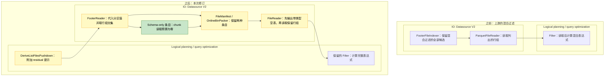

# [Data] 在 Parquet listing 阶段裁剪分区与数据混合过滤条件

这次按 [Aarrya 的建议](https://github.com/ray-project/ray/pull/67855#issuecomment-6671027378)，把分区与数据混合过滤的裁剪移到了 Parquet listing。对 [#67567](https://github.com/ray-project/ray/issues/67567) 中的查询，读取 worker 只接收可能匹配的行组，完整行过滤仍然保留。

在这个 PR 之前，`(year == "2023") | (x < 1000)` 这样的混合过滤会让全部行组进入读取。最初的 PR 在 reader 中决定裁剪；这次改为读取 footer 时，逐文件代入分区值，再将选中的行组与已有下推数据过滤允许的行组取交集。对这个查询，`year=2023` 下的文件保留全部行组；对其他年份，可以通过 footer 用 `x < 1000` 排除行组。

涉及的子系统：**Logical planning / query optimization（逻辑规划／查询优化）** 和 **IO**，包括 Datasource V2 的 listing、manifest、packing 和 reader。



## 根据评审意见改了什么

分区替换现在放在通用 helper 中，使用 Ray 已有的列替换 visitor。Parquet 适配器负责核对分区值和文件 schema。已有数据过滤下推不再禁用这项优化；该过滤和完整 residual 过滤都保留。支持的表达式扩展到嵌套 AND／OR／NOT、null 检查和长度受限的字面量 IN，而不只是最初的比较模式。

保留空结果的 schema 需要单独处理。只为取得 schema 而保留一个数据行组，仍然会产生读取。现在 listing 对具有已核对布局的 shard 至多发出一个 schema-only manifest 条目，与仍需读取的数据 chunks 一起传递。配对 reader 按正常的分区列处理和投影，在打开数据文件前先生成带类型的空表；即使后面还有数据 chunks 也会这样做，因此直到执行时过滤才返回零行，schema 也不会丢失。条目保留真实源文件大小，chunk 读取预算为零，它不代表 residual 过滤的精确行数。

Aarrya，[#67037](https://github.com/ray-project/ray/pull/67037) 也在调整共享 manifest／count 接口，你会把这种给 reader 的指令放在 manifest 中吗？它避免了修改通用执行器，但也增加了一个代表 schema、而非待扫描数据的条目。在扩大数据源支持之前，我想先讨论清楚这个选择。

## 适用范围和错误行为

新路径限于使用内建本地 Hive Parquet 的根 `Filter → ReadFiles → ListFiles` 查询。下表中的“回退”表示不采用新的 residual hint，已有下推和完整行过滤仍然执行。表达式受支持，也不代表统计信息一定能排除行组。

### 表达式覆盖

这些限制针对新 hint 使用的 residual 表达式，不限制已经下推的数据过滤。Residual 必须引用分区列，而且其中每一部分都必须受支持。

| 表达式 | Hint 接受的情况 | 回退的情况 |
|---|---|---|
| 有符号整数比较 | `int8`／`int16`／`int32`／`int64` 的 `==`、`!=`、`<`、`<=`、`>`、`>=`；字面量须在字段位宽范围内 | 越界字面量，例如将 `int8` 字段与 `128` 比较 |
| String／bool 比较 | `==`、`!=` | `name < "m"` 这样的大小比较 |
| 布尔组合和 null 检查 | 嵌套 AND／OR／NOT；对列或支持的字面量做 `is_null`、`is_not_null` | 任一分支不受支持，就不采用整个 hint，即使另一分支有可能化简为 true |
| 字面量 IN | 1–256 个同类型、非 null 的值，与 int64、bool 或 string 输入类型匹配 | 窄整数 IN、混合类型、含 null、空列表或超过 256 个值 |
| 列与列比较 | 类型兼容，且分区操作数替换成带类型的字面量，例如 `x < partition_limit` | 替换后仍有两个列操作数 |
| 浮点、算术和 UDF | `float64` 可作为不参与表达式的数据列 | Residual 中含浮点操作数、算术或 UDF |

统计不足时仍可能保留全部行组，IN 的裁剪能力也取决于 Arrow 版本。本次不包含 [#67943](https://github.com/ray-project/ray/pull/67943) 的算术边界或前缀谓词推导。

### 扩展到其他数据源的考量

我把可复用的表达式处理与数据源检查分开了。通用 helper 接收已经转换为 reader 类型的分区值，再调用已有的列替换 visitor；它不解析路径、不读取统计，也不决定输出 schema。Parquet 适配器在使用替换结果前，需要确认三件事：

- **代入的值必须就是 reader 返回的值。** 当前适配器使用 reader 的 Hive 解析和类型转换。其他 reader 对同一路径可以有不同解释：例如 [MCAP 保留消息自身的 `topic`](https://github.com/m4ru1/ray/blob/17bbe5978dfb326746fca975be4a3abb9277a6b7/python/ray/data/_internal/datasource_v2/formats/mcap/mcap_reader.py#L247-L272)，`topic=camera/` 下的一条 `topic="lidar"` 消息，不能因为目录名就被当成 `topic="camera"`。路径解析正确，不等于可以用路径值替换该列。
- **数据源需要能排除自己的读取单元。** Parquet 先核对物理字段类型与固定 reader schema，再用 footer 统计选择行组。物理 `INT32` 本身不够，因为它可能表示整数、日期或 decimal。ORC 已共享 Arrow scanner 和分区 parser，但当前 indexer 按整文件列出，且 [reader 没有实现原生 stripe 裁剪](https://github.com/m4ru1/ray/blob/17bbe5978dfb326746fca975be4a3abb9277a6b7/python/ray/data/_internal/datasource_v2/formats/orc/orc_file_reader.py#L34-L40)；只复用表达式替换，并不会补上这一步。
- **裁掉所有数据行组后，输出 schema 仍须正确。** Schema-only 消费逻辑已放在通用 `FileReader` 中，ORC 也继承它。它沿用正常的分区列插入和投影，但依赖 producer 事先核对布局；目前只有 Parquet 路径生成这种核对过的条目。其他 reader 的额外字段、转换或 schema 演变仍需相应检查。只为 schema 保留一个数据行组可以避免这项新约定，却也会保留一次不必要的读取。

所以本次只启用已核对的内建本地 Hive Parquet scanner／indexer 组合。远程文件系统和子类暂不启用，是因为这里尚未建立相同约定，并非分区替换原理上只能用于本地文件。其他 indexer 可以实现 `FileIndexer.with_residual_pruning`，默认实现不改变 listing。具体实现仍需建立与自身 reader 的约定，并补充真实 reader 对值、空结果 schema 和错误行为的测试。

| 范围 | 本次启用 | 保持已有路径 |
|---|---|---|
| 数据源 | 内建本地 Hive Parquet，包括正常的文件系统重试包装 | 远程／自定义文件系统、非 Hive 分区、scanner／indexer 子类 |
| Schema 与 reader 配置 | 固定且匹配的原始类型逻辑／物理 schema，以及正常投影 | 不支持的类型、nested／extension 类型、schema／field metadata、不兼容的 footer 布局、合成列或自定义 Parquet 格式选项 |
| 查询／执行 | 根 `Filter → ReadFiles → ListFiles`，不保序、不 shuffle | 下游 map、count／limit 计划、保序／shuffle、checkpoint 或允许忽略错误块 |

### 错误行为

必需的 footer 读取仍然发生，实际执行的读取路径中的错误会正常传递。被裁掉的行组不会仅为重现错误而读取或求值：如果数据页损坏或除零表达式只出现在这些行组中，可能不再报错。

只含 schema-only 条目的读取任务会直接返回，不构造数据 scanner。因此，原本在这一步检查的参数，例如无效 `batch_size`，在没有数据需要读取时可能不会被校验。不增加单独的校验步骤，也不按 `batch_size` 限制 listing hint；如果还有数据 chunks，仍执行正常 reader 路径。这与最初 PR 只要存在数据过滤下推就禁用裁剪的选择不同，也不保证被裁掉的工作仍触发相同错误。

## 测试

谢谢 [Jadiouo](https://github.com/ray-project/ray/pull/67855#pullrequestreview-5796666582) 也检查了基线。旧端到端测试即使读完全部数据也能通过。现在的测试观察真实读取 worker，以关闭裁剪的运行作对照，并检查消费的行组、输出及 schema。计划回归放在 listing 规则的测试模块中，位于 main guard 之前。

原 issue 的回归比较两臂完整的 `(x, year, month)` 多重集，包含重复计数，并核对 schema。PyArrow 17.0.0 和 23.0.1 下均返回相同的 5,000 行完整核对结果，实际消费从 160 个行组降至 25 个，从 32 个数据文件降至五个。Footer 读取仍然发生；这些是数据消费计数，不是总打开次数或字节数。

定向 unit、真实 worker 和 footer 测试在两个 Arrow 版本下均为 **306 项通过、一个预期失败**。预期失败仍是已知情况：分区裁剪在 footer listing 前移除全部文件，没有 schema 条目到达 reader。Jadiouo 原来的 20 条查询脚本没有作为整组重新运行。

功能测试运行于整合前的修订版及其匹配的 Ray Core。该版本的变更源码和测试文件与最终整合版相同；核对过的 Data 源码中，其余差异只有一行无关的上游文档说明。整合后尚未重新运行全部 306 项。下方性能实验则使用最终整合版及其匹配 Core。这些本地检查不代表上游完整 CI 通过。

原 issue 回归的测试入口：

```bash
python -m pytest \
  'python/ray/data/tests/datasource_v2/test_schema_only_manifest.py::test_empty_output_schema_and_actual_reads[original]'
```

## 性能

我在最终 commit `17bbe597` 上重新测了一轮，对照干净上游 `aa00fdbb`，使用匹配的 Ray Core 和 PyArrow 23.0.1。

对 3.735 GB 的选择性查询，新版本把实际读取从 3,520 个行组降到 440 个，仍返回相同的 450,560 行。四对实验中，查询耗时降低 8.50–27.25%，降幅中位数为 14.10%。两版都仍需从全部 55 个文件读取数据。

我另外用一个保留全部行的小查询检查额外开销。新版本在这个查询上**四对全部变慢**，增加 86.9–335.6 ms，也就是 2.35–9.60%，增幅中位数为 5.91%。

这轮测的是本地文件，每次先预读，没有清缓存。容器触及 5 GiB 内存上限并发生回收，没有观察到 OOM 或 spill。选择性查询的上游耗时本身就在 6.779–9.061 秒之间波动，四对结果还不足以判断这个收益幅度能否稳定复现。冷存储和远程文件系统的表现尚未测试。

<details>
<summary>测试数据、全部计时和运行方式</summary>

选择性查询的数据有 55 个 Hive 分区文件，每个文件 64 组、每组 1,024 行，每行带一个 1,024 字节的 ASCII string。文件不压缩、不使用字典编码，只给 `x` 写统计信息，总大小为 3,735,281,660 字节。过滤条件 `(p == -1) | (x >= 57344)` 保留每个文件最后八组。

小查询的数据有 32 个文件，每个文件五组，总大小 205,457 字节。过滤条件 `(year == "2023") | (x >= 0)` 保留全部 32,000 行、160 组；本修订的 hint 在这个场景也已启用。

两版交替先后运行，每个查询的四对结果全部列在下面。

选择性查询：

| 配对顺序 | 上游 | 本修订 | 查询耗时变化 |
|---|---:|---:|---:|
| 上游 → 修订 | 9.0607 s | 6.5920 s | −27.25% |
| 修订 → 上游 | 8.7438 s | 7.0726 s | −19.11% |
| 上游 → 修订 | 6.7789 s | 6.2025 s | −8.50% |
| 修订 → 上游 | 6.9334 s | 6.3033 s | −9.09% |

小规模全保留对照：

| 配对顺序 | 上游 | 本修订 | 查询耗时变化 |
|---|---:|---:|---:|
| 上游 → 修订 | 3.7024 s | 3.7893 s | +86.9 ms（+2.35%） |
| 修订 → 上游 | 3.5155 s | 3.7555 s | +240.1 ms（+6.83%） |
| 上游 → 修订 | 3.4964 s | 3.8320 s | +335.6 ms（+9.60%） |
| 修订 → 上游 | 3.5988 s | 3.7785 s | +179.8 ms（+4.99%） |

实验使用 32 GiB Mac 上的 Linux ARM64 Docker 和 Python 3.11.18。容器分配四 CPU、5 GiB 内存；Ray 使用两 CPU、1 GiB object store 和 512 MiB Data 软预算。读取不保序，关闭 spilling 和 usage statistics。

计时前，我先用四次独立运行核对完整输出，包括 payload、schema 和重复计数，并观察实际读取的行组。每次正式运行都会顺序预读全部数据，再启动新的 Ray 实例；计时从创建 Dataset／filter 开始，直到结果全部取完。结果按每批 4,096 行的 Arrow 批次消费，不预取，保留行数、schema 和 null 检查；预读和 Ray 启动不计入查询耗时。

行组减少多少可以直接观察到；具体省了多少 I/O 字节和打开文件的次数，这次没有测。预读过的数据在计时时还有多少留在缓存里，也没有确认。

</details>

本次继续在现有 PR 中实现 #67567 提出的逐文件分区替换，与 #67943 的谓词推导、#67037 的 manifest／count 改动不同；尚未测试它们组合后的行为。

AI assistance was used.
