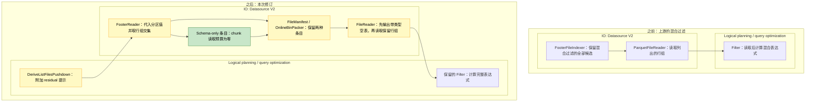

# [Data] 在 Parquet listing 阶段裁剪分区与数据混合过滤条件

这次按 [Aarrya 的建议](https://github.com/ray-project/ray/pull/67855#issuecomment-6671027378)，把分区与数据混合过滤的裁剪移到了 Parquet listing。对 [#67567](https://github.com/ray-project/ray/issues/67567) 中的查询，读取 worker 只接收可能匹配的行组，完整行过滤仍然保留。

在这个 PR 之前，`(year == "2023") | (x < 1000)` 这样的混合过滤会让全部行组进入读取。最初的 PR 在 reader 中决定裁剪；这次改为读取 footer 时，逐文件代入分区值，再将选中的行组与已有下推数据过滤允许的行组取交集。对这个查询，`year=2023` 下的文件保留全部行组；对其他年份，可以通过 footer 用 `x < 1000` 排除行组。

涉及的子系统：**Logical planning / query optimization（逻辑规划／查询优化）** 和 **IO**，包括 Datasource V2 的 listing、manifest、packing 和 reader。



## 根据评审意见改了什么

分区替换现在放在通用 helper 中，使用 Ray 已有的列替换 visitor。Parquet 适配器负责核对分区值和文件 schema。已有数据过滤下推不再禁用这项优化；该过滤和完整 residual 过滤都保留。支持的表达式扩展到嵌套 AND／OR／NOT、null 检查和长度受限的字面量 IN，而不只是最初的比较模式。

保留空结果的 schema 需要单独处理。只为取得 schema 而保留一个数据行组，仍然会产生读取。现在 listing 对具有已核对布局的 shard 至多发出一个 schema-only manifest 条目，与仍需读取的数据 chunks 一起传递。配对 reader 按正常的分区列处理和投影，在打开数据文件前先生成带类型的空表；即使后面还有数据 chunks 也会这样做，因此直到执行时过滤才返回零行，schema 也不会丢失。条目保留真实源文件大小，chunk 读取预算为零，它不代表 residual 过滤的精确行数。

Aarrya，[#67037](https://github.com/ray-project/ray/pull/67037) 也在调整共享 manifest／count 接口，你会把这种给 reader 的指令放在 manifest 中吗？它避免了修改通用执行器，但也增加了一个代表 schema、而非待扫描数据的条目。在扩大数据源支持之前，我想先讨论清楚这个选择。

## 适用范围和错误行为

新路径限于使用内建本地 Hive Parquet 的根 `Filter → ReadFiles → ListFiles` 查询。共享替换代码，并不能保证其他数据源取得分区值和生成输出 schema 的方式相同。

<details>
<summary>支持的表达式及回退情况</summary>

- 有符号 `int8`、`int16`、`int32`、`int64` 比较，字面量必须在字段位宽范围内。列与列比较必须通过分区替换变成支持的形式；替换后仍有两个列操作数，就不使用提示。
- String／bool 的相等与不等比较、叶节点 null 检查、嵌套 AND／OR／NOT。Residual 表达式中的每一部分都必须受支持。
- 1–256 个同类型非 null 字面量组成的 IN 列表，输入限 int64、bool 或 string。不支持窄整数 IN。
- Float64 可以作为不参与表达式的数据列。Residual 表达式中的浮点操作数、算术和 UDF 回退到已有路径。
- 远程／自定义文件系统、scanner／indexer 子类、非 Hive 分区回退。内建本地文件系统的普通重试包装受支持。
- 不支持的类型或 nested／extension 类型、schema／field metadata、合成列、自定义 Parquet 格式选项回退。下游 map、count／limit 计划、保序或 shuffle、checkpoint、允许忽略错误块也使用已有路径。

统计不足时仍可能保留全部行组，IN 的裁剪能力也取决于 Arrow 版本。本次不包含 [#67943](https://github.com/ray-project/ray/pull/67943) 的算术边界或前缀谓词推导。

</details>

必需的 footer 读取仍然发生，实际执行的读取路径中的错误会正常传递。被裁掉的行组不会仅为重现错误而读取或求值：如果数据页损坏或除零表达式只出现在这些行组中，可能不再报错。

只含 schema-only 条目的读取任务会直接返回，不构造数据 scanner。因此，原本在这一步检查的参数，例如无效 `batch_size`，在没有数据需要读取时可能不会被校验。不增加单独的校验步骤，也不按 `batch_size` 限制 listing hint；如果还有数据 chunks，仍执行正常 reader 路径。这与最初 PR 只要存在数据过滤下推就禁用裁剪的选择不同，也不保证被裁掉的工作仍触发相同错误。

## 测试

谢谢 [Jadiouo](https://github.com/ray-project/ray/pull/67855#pullrequestreview-5796666582) 也检查了基线。旧端到端测试即使读完全部数据也能通过。现在的测试观察真实读取 worker，以关闭裁剪的运行作对照，并检查消费的行组、输出及 schema。计划回归放在 listing 规则的测试模块中，位于 main guard 之前。

原 issue 的回归比较两臂完整的 `(x, year, month)` 多重集，包含重复计数，并核对 schema。PyArrow 17.0.0 和 23.0.1 下均返回相同的 5,000 行完整核对结果，实际消费从 160 个行组降至 25 个，从 32 个数据文件降至五个。Footer 读取仍然发生；这些是数据消费计数，不是总打开次数或字节数。

两个 Arrow 版本的定向检查均为 **306 项通过、一个预期失败**：包括 229 项 unit、21 项 schema-only 端到端和 56 项 footer-reader／chunking 测试。预期失败仍是已知情况：分区裁剪在 footer listing 前移除全部文件，没有 schema 条目到达 reader。Jadiouo 原来的 20 条查询脚本没有作为整组重新运行。

这些测试使用 `eb672700` 加最终的纯测试 oracle 更新，Python 3.11.18、匹配的 Ray Core `891a5a89`，并关闭 usage statistics。最终整合 commit `17bbe597` 的变更源码／测试文件均与实测版本一致；837 个 Data 文件中仅有上游 `llm.py` 的一行无关文档说明不同。306 项测试尚未在该整合版本上重新运行。下方性能实验则使用最终整合版本及匹配的 `aa00fdbb` Core。这些是本地检查，不代表上游完整 CI 通过。

<details>
<summary>测试命令和源码身份</summary>

两个 Arrow 环境分别在 `/workspace` 执行以下命令，其中 `python` 指 `/tmp/check-venv/bin/python`。Harness 设置 `PYTHONPATH=/harness`、`PYTEST_PLUGINS=identity_guard,usage_state`、`PYTHONDONTWRITEBYTECODE=1` 和 `RAY_USAGE_STATS_ENABLED=0`。插件负责核对加载的源码和运行时；仅复制 pytest 命令不能复现这项身份审计。

```bash
python -m pytest -v -ra -p no:cacheprovider \
  --basetemp=/out/pytest-original --junitxml=/out/original.xml \
  'python/ray/data/tests/datasource_v2/test_schema_only_manifest.py::test_empty_output_schema_and_actual_reads[original]'

python -m pytest -v -ra -p no:cacheprovider \
  --basetemp=/out/pytest-unit --junitxml=/out/unit.xml \
  python/ray/data/tests/unit/datasource_v2/test_listing_pruning_context.py \
  python/ray/data/tests/unit/datasource_v2/test_listing_integration.py \
  python/ray/data/tests/unit/datasource_v2/test_schema_only_manifest.py \
  python/ray/data/tests/unit/datasource_v2/test_file_reader_layout.py \
  python/ray/data/tests/unit/datasource_v2/test_listing_read_audit.py \
  python/ray/data/tests/unit/datasource_v2/test_arrow_file_scanner.py \
  python/ray/data/tests/unit/datasource_v2/test_online_bin_packer.py \
  python/ray/data/tests/unit/datasource_v2/test_chunk_metadata.py \
  python/ray/data/tests/unit/datasource_v2/test_derive_list_files_pushdown.py

python -m pytest -v -ra -p no:cacheprovider \
  --basetemp=/out/pytest-worker --junitxml=/out/worker.xml \
  python/ray/data/tests/datasource_v2/test_schema_only_manifest.py \
  python/ray/data/tests/datasource_v2/test_footer_reader.py \
  python/ray/data/tests/datasource_v2/test_footer_chunking.py -k 'not original'
```

三个阶段依次得到 1 项通过、229 项通过、76 项通过／1 项预期失败／1 项未选中。最后阶段未选中的原 issue 用例已经先单独运行。Schema-only 文件合计 21 项通过／1 项预期失败，最后阶段的其余 56 项为 footer 相关测试。所有阶段均成功退出。纯 oracle 更新的 Black、Ruff、导入排序和 Pyrefly 检查通过。

- `eb6727009e5305106f45607cffd549e4ca86e512` 上的纯测试补丁 SHA-256：`3a57d79a8d4593146936a828ef5c68a830c870993bb12984fa03017e5995e6bb`。
- 实测 837 文件源码 manifest：`7337a1424907d06858689c5955814161710b34060d7ff669875edb6a6929bdb7`。
- 最终整合 commit：`17bbe5978dfb326746fca975be4a3abb9277a6b7`，基于上游 `aa00fdbb6c64a358f19e2f523068d612b19874de`。
- 最终整合版 837 文件 manifest：`958afc6d778eee15f1ef0aa733d5f003bb7320271ca8e26d06a3dff256b0bd6b`。

</details>

## 性能

这里的耗时均为最终 commit `17bbe597` 与干净上游 `aa00fdbb` 的新实验，使用匹配 Core 和 PyArrow 23.0.1。可裁 fixture 的实际文件大小为 **3,735,281,660 字节（3.735 GB）**：55 个 Hive 分区文件，每个文件 64 组、每组 1,024 行，每行包含 1,024-byte payload。过滤 `(p == -1) | (x >= 57344)` 保留每个文件最后八组。Payload 为 1,024 个 ASCII 字节的 string；文件不压缩、不使用字典编码，仅 `x` 列写入 statistics。独立诊断完整核对全部 450,560 行的内容、schema 和重复计数，包括每个 payload 字节。实际消费从 3,520 组降至 440 组，两臂仍从全部 55 个文件消费数据。

小规模全保留对照使用 `(year == "2023") | (x >= 0)`，共 205,457 字节，32 个文件、每文件五组。两臂均消费全部 160 组，返回相同的 32,000 行完整核对结果；候选的 hint 确实启用。

每个场景四对，交替按“上游 → 修订”和“修订 → 上游”执行。可裁查询耗时降低 8.50–27.25%，配对降时的中位数为 14.10%（上游／修订比值的中位数为 1.168×）。小规模对照则**四对全部变慢**，增加 86.9–335.6 ms，即 2.35–9.60%，增幅中位数为 5.91%。

<details>
<summary>全部正式计时及实验条件</summary>

可裁场景：

| 配对顺序 | 上游 | 本修订 | 查询耗时变化 |
|---|---:|---:|---:|
| 上游 → 修订 | 9.0607 s | 6.5920 s | −27.25% |
| 修订 → 上游 | 8.7438 s | 7.0726 s | −19.11% |
| 上游 → 修订 | 6.7789 s | 6.2025 s | −8.50% |
| 修订 → 上游 | 6.9334 s | 6.3033 s | −9.09% |

小规模全保留对照：

| 配对顺序 | 上游 | 本修订 | 查询耗时变化 |
|---|---:|---:|---:|
| 上游 → 修订 | 3.7024 s | 3.7893 s | +86.9 ms（+2.35%） |
| 修订 → 上游 | 3.5155 s | 3.7555 s | +240.1 ms（+6.83%） |
| 上游 → 修订 | 3.4964 s | 3.8320 s | +335.6 ms（+9.60%） |
| 修订 → 上游 | 3.5988 s | 3.7785 s | +179.8 ms（+4.99%） |

实验在 32 GiB Mac 上的 Linux ARM64 Docker 中运行，Python 3.11.18、PyArrow 23.0.1。容器分配四 CPU、内存上限 5 GiB；Ray 使用两 CPU、1 GiB object store、512 MiB Data 软预算。关闭 spilling 和 usage statistics，使用本地文件系统、无保序读取。

每次运行启动新的 Ray 实例，并在启动前顺序预读全部 fixture。查询计时从构建 Dataset／filter 之前开始，到 `iter_batches(batch_size=4096, batch_format="pyarrow", prefetch_batches=0)` 消费完结束，包括 listing、读取、过滤、传输和行数／schema／null 检查。不包括 Ray 启停、预读、源码哈希和统计提取；启动耗时单独记录为 2.14–3.42 秒。完整 payload 哈希和读取观察器只用于正式计时前的四次诊断，不在 16 个正式样本内。正式样本没有失败或排除项。

</details>

没有清空缓存，预读也不保证 fixture 持续驻留内存。容器触及 5 GiB 上限并发生内存回收，没有 OOM 或观察到的 spill。上游可裁场景耗时在 6.779–9.061 秒间波动。这样的四对实验不能确定稳定的回归界限，也不能说明冷存储或远程文件系统表现。没有测量总打开次数或精确 I/O 字节数。

本次继续在现有 PR 中实现 #67567 提出的逐文件分区替换，与 #67943 的谓词推导、#67037 的 manifest／count 改动不同；尚未测试它们组合后的行为。

AI assistance was used.
