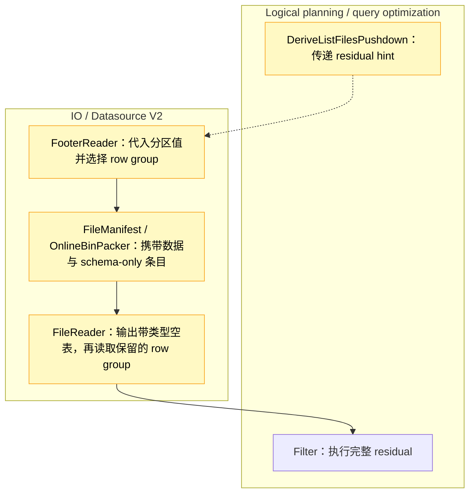

# [Data] 在 Parquet 文件列举阶段裁剪混合分区列与数据列的过滤条件

## 这次改动解决什么问题

这个 PR 让 Datasource V2 在列举 Parquet 文件时，利用每个文件的分区值裁剪 row group，解决 [#67567](https://github.com/ray-project/ray/issues/67567) 中的全量扫描问题。最终决定保留哪些行的完整过滤条件仍然会执行。

**改动前：** 对于 `(year == "2023") | (x < 1000)`，单独把任一半作为读取的必要条件，都会漏掉另一半匹配的行。2023 年以外的文件仍可能包含较小的 `x`，而 2023 年的行无论 `x` 是多少都应保留。因此，Ray 把整个混合 OR 留在读取之后执行，读取所有候选 row group。

**改动后：** 列举阶段从每个文件的路径中取得年份并代入表达式。对于 `year=2023` 下的文件，条件变成 true；对于其他文件，条件变成 `x < 1000`。这样就能利用 Parquet footer 统计信息，在生成读取任务前排除不可能匹配的 row group。必需的 footer 读取仍然会进行。

## 实现方式

按照 [Aarrya 的评审建议](https://github.com/ray-project/ray/pull/67855#issuecomment-6671027378)，这次修订把裁剪决定从 reader 移到了 footer 列举阶段。逐文件表达式筛出的 row group，会与已有下推数据过滤器允许的 row group 取交集。已有下推过滤器和上层完整的 residual filter 都保留。

分区值替换放在通用 helper 中，复用 Ray 已有的列替换 visitor。Parquet 适配层负责确认：代入的值和物理 schema 与 reader 实际返回的内容一致。其他 indexer 可以通过 `FileIndexer.with_residual_pruning` 接入，但必须与自己的 reader 建立同样的保证，并实现对应读取单元的裁剪。布局允许时，可以复用共享的空表输出路径。

例如，ORC 已经共享 Arrow reader 和分区解析器，但[尚未实现原生 stripe 裁剪](https://github.com/m4ru1/ray/blob/17bbe5978dfb326746fca975be4a3abb9277a6b7/python/ray/data/_internal/datasource_v2/formats/orc/orc_file_reader.py#L34-L40)。MCAP 在消息与 `topic=.../` 路径冲突时，[保留消息自己的 `topic`](https://github.com/m4ru1/ray/blob/17bbe5978dfb326746fca975be4a3abb9277a6b7/python/ray/data/_internal/datasource_v2/formats/mcap/mcap_reader.py#L247-L272)，因此仅仅解析路径正确，还不足以证明可以代入这个值。本 PR 只启用内置的本地 Hive Parquet 路径。

涉及子系统：**Logical planning / query optimization** 和 **IO**。



### 没有匹配数据时，如何保留 schema

如果所有数据 row group 都被删除，空结果的 schema 也可能随之丢失。仅为恢复 schema 而留下一个 row group，又会保留一次不必要的数据读取。

因此，列举阶段在验证 reader 布局后，每个 shard 最多输出一个 schema-only manifest 条目。Reader 沿用正常的分区列添加和投影逻辑，输出一个带类型的空表，不打开这个条目对应的数据文件。即使还有其他 row group 要读，也先输出空表，这样后续行过滤把所有行排除时，schema 仍然存在。这个条目的读取预算为零，仍保留源文件的真实大小，也不代表 residual filter 结果的精确行数。

Aarrya，这条指令放在 manifest 中是否合适？它避免了修改通用 executor，但扩展了 [#67037](https://github.com/ray-project/ray/pull/67037) 也在修改的共享接口。

### 适用范围与限制

这个 hint 是可选优化。表达式、数据源或布局不受支持时，仍使用原有读取路径和过滤器。Residual 必须引用分区列；任一分支不受支持，整个 hint 就会放弃。

| 方面 | 当前范围 |
|---|---|
| 数据源与 schema | 内置本地 Hive Parquet，包括正常的重试包装，要求兼容的固定基础类型 schema，支持正常投影。不启用远程或自定义文件系统、scanner/indexer 子类、嵌套或扩展类型、schema/字段元数据、合成列及自定义 Parquet format 选项。 |
| 查询形态 | 根节点为 `Filter → ReadFiles → ListFiles`，无保序和 shuffle。下游 map、count/limit、checkpoint 及允许忽略 block 错误的执行方式不启用。 |
| 比较表达式 | 有符号整数支持 `== != < <= > >=`，比较常量必须落在字段位宽范围内。Bool/string 支持 `==` 和 `!=`。类型兼容的列间比较，在替换后至少一侧成为常量时可使用。 |
| 逻辑和 null 表达式 | 嵌套 AND/OR/NOT，以及列或受支持常量上的叶节点 `is_null/is_not_null`。 |
| 字面量 IN | 输入为 `int64`、bool 或 string，含 1–256 个类型匹配、非 null 的常量。窄整数 IN 退回原路径。 |

Residual 中的浮点操作数、算术和 UDF 暂不支持。缺少统计信息时可能无法裁剪，IN 能否裁剪也取决于 Arrow 版本。

裁剪不会为了复现错误而执行已经跳过的工作。必需的 footer 读取和实际执行的读取路径仍正常报告错误，但只存在于被跳过 row group 中的损坏页面或失败表达式，可能不再报错。只有 schema-only 条目的任务也不会构造 scanner，因此原本在那里校验的选项，例如无效的 `batch_size`，可能不会被检查。没有额外的验证流程，也没有 `batch_size` 门槛。

## 测试

[Jadiouo 指出](https://github.com/ray-project/ray/pull/67855#pullrequestreview-5796666582)，旧 e2e 测试在 base 上也能通过。现在的测试同时检查实际读取和输出，并通过真实 worker 与关闭裁剪的对照组比较；规划回归测试也已放到测试模块的 main guard 之前。原始 issue 的回归用例校验完整的 `(x, year, month)` 多重集、重复次数和 schema：两边都返回相同的 5,000 行，实际读取从 **160 降到 25 个 row group**，涉及的数据文件从 **32 降到 5 个**。这些是数据消费量，不是总文件打开次数或读取字节数。

已记录的本地检查在 PyArrow 17.0.0 和 23.0.1 上分别得到 **306 passed、1 xfailed**。已知的预期失败是：分区裁剪在 footer 列举前就排除了全部文件，因此没有 schema 条目能到达 reader。

这些功能检查使用的是 `eb672700` 加 oracle-only 测试修改，以及匹配的 Ray Core `891a5a89`。所改源码和测试文件在最终整合版中保持一致，但尚未在 `17bbe597` 上重跑完整选择集。Jadiouo 原来的 20 条查询脚本也没有作为完整集合重跑。这不代表上游完整 CI 已通过。

<details>
<summary>两个 Arrow 版本使用的测试选择</summary>

下面列出所用测试选择，省略运行环境设置和日志路径。

```bash
# Original issue
python -m pytest -v -ra -p no:cacheprovider \
  'python/ray/data/tests/datasource_v2/test_schema_only_manifest.py::test_empty_output_schema_and_actual_reads[original]'

# Unit tests
python -m pytest -v -ra -p no:cacheprovider \
  python/ray/data/tests/unit/datasource_v2/test_listing_pruning_context.py \
  python/ray/data/tests/unit/datasource_v2/test_listing_integration.py \
  python/ray/data/tests/unit/datasource_v2/test_schema_only_manifest.py \
  python/ray/data/tests/unit/datasource_v2/test_file_reader_layout.py \
  python/ray/data/tests/unit/datasource_v2/test_listing_read_audit.py \
  python/ray/data/tests/unit/datasource_v2/test_arrow_file_scanner.py \
  python/ray/data/tests/unit/datasource_v2/test_online_bin_packer.py \
  python/ray/data/tests/unit/datasource_v2/test_chunk_metadata.py \
  python/ray/data/tests/unit/datasource_v2/test_derive_list_files_pushdown.py

# Worker/footer tests
python -m pytest -v -ra -p no:cacheprovider \
  python/ray/data/tests/datasource_v2/test_schema_only_manifest.py \
  python/ray/data/tests/datasource_v2/test_footer_reader.py \
  python/ray/data/tests/datasource_v2/test_footer_chunking.py \
  -k 'not original'
```

</details>

## 性能

这次用最终提交 `17bbe597` 与上游 `aa00fdbb`，在同一套 **59.75 GB 数据**上比较了保留全部、一半和八分之一 row group 的查询。每档运行两对，第二对交换版本顺序。下表耗时单位为秒，均按 **上游 → 本次修订** 排列。

| 保留的 row group 比例 | 读取组数，上游 → 修订版 | 第一对 | 第二对 |
|---|---:|---:|---:|
| 100% | 3,520 → 3,520 | 271.308 → 286.169 | 289.937 → 288.712 |
| 50% | 3,520 → 1,760 | 289.030 → 130.144 | 293.935 → 109.925 |
| 12.5% | 3,520 → 440 | 269.824 → 15.784 | 233.917 → 9.551 |

保留 50% 时，查询耗时降低 55.0–62.6%；保留 12.5% 时，降低 94.2–95.9%。全部保留时没有一致方向：一对慢了 5.48%，另一对耗时减少 0.42%。每一档的两版仍然都从全部 55 个文件读取数据。

云端大数据的三档过滤条件均为 `(p == -1) | (x >= threshold)`，threshold 分别为 0、524288 和 917504。独立检查比较了完整输出，包括每个 payload 字节、schema 和重复次数，并确认实际读取的 row group。正式计时只保留行数、schema 和 null 检查，覆盖查询构建到消费完全部结果，不包含 Ray 启动和完整输出检查。

运行环境是 16 vCPU、32 GB 的 Linux x86_64 云主机，Ray 使用八个 CPU，数据存于云 SSD 块存储，Python 3.10.12、PyArrow 23.0.1。实验没有清缓存，完整验证也在计时前运行，因此未受控的缓存复用可能贡献了 12.5% 档的一部分显著收益。每档仅两对结果，不足以判断稳定开销，也不能预测冷缓存或远程文件系统上的表现。

## 相关工作

这是在现有 PR 中继续解决 #67567，不实现 [#67943](https://github.com/ray-project/ray/pull/67943) 的算术/prefix 派生谓词，也不替代 [#67037](https://github.com/ray-project/ray/pull/67037) 的 manifest/count 改动。它们组合后的行为尚未测试。

本 PR 使用了 AI 辅助。
