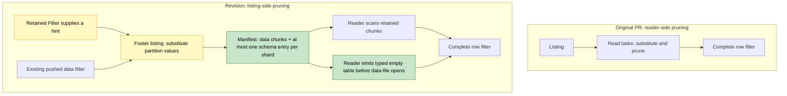

# [Data] Prune mixed partition/data filters during Parquet listing

In [#67567](https://github.com/ray-project/ray/issues/67567), `(year == "2023") | (x < 1000)` scans data from all 32 files even though only five can contribute rows. The first version of this PR tried to avoid those reads inside the reader. This revision moves that decision into listing, as [Aarrya suggested](https://github.com/ray-project/ray/pull/67855#issuecomment-6671027378), so read tasks receive only the row groups that may match.

## What changed after the review

Thanks, Aarrya. Moving this earlier also let me address the other parts of your comment. The partition substitution now uses Ray’s existing column-substitution visitor in a common helper; the Parquet adapter checks the partition values and file schema. An existing pushed data filter no longer disables the optimization. Listing applies that filter first, then intersects the remaining groups with those selected after substituting the partition values. Both the original pushed filter and the complete row filter remain in place.

For the issue’s query, a file under `year=2023` needs all its groups. For any other year, the expression becomes `x < 1000`, so its footer can exclude groups. This also works with nested AND/OR/NOT, null checks and bounded literal IN lists, within the type restrictions below.

The less straightforward part was an empty result. Dropping every group can leave the reader with nothing from which to produce the output schema. An earlier attempt kept a group from each excluded file, but that still read data the predicate had ruled out.

This version adds a schema-only manifest entry: an instruction for the reader to emit an empty table with the right schema. Listing emits at most one per shard whose layout it can verify, alongside any surviving data chunks. The paired reader emits that empty table, with its normal partition columns and projection, before opening data files. It does this even when data chunks follow, which also covers a filter that returns no rows only at execution time. The entry keeps the real source file size but gives its chunk a zero read budget; it is not an exact count for the residual filter.

Aarrya, since [#67037](https://github.com/ray-project/ray/pull/67037) also changes the shared manifest/count interfaces, is the manifest the right place for this reader instruction? That seems preferable to changing the general executor, but I would like to settle the interface before extending this to other sources.



## Scope

For now, the new path handles a root `Filter → ReadFiles → ListFiles` query using built-in local Hive Parquet. Float64 can be an unreferenced payload column, but floating-point predicates and arithmetic still use the existing path. I kept the source restriction because another filesystem or scanner can derive partition values and output columns differently; sharing the substitution code does not establish those reader contracts.

<details>
<summary>Supported expressions and fallback cases</summary>

| Supported expressions/types | Limit |
|---|---|
| Signed `int8`, `int16`, `int32`, `int64` comparisons | Integer literals must fit the field width. A column-to-column comparison must resolve through partition substitution; if two columns remain, the hint is declined. |
| String/bool equality and inequality; leaf null checks | No floating-point operands. |
| Nested AND, OR and NOT | Each part must be supported, including multi-branch ORs. |
| Literal IN lists | 1–256 homogeneous, non-null values; int64, bool or string input. Narrow-integer IN is not supported. |
| Float64 payload | Allowed only when it does not participate in the pruning expression. |

| Falls back to the existing path | Why |
|---|---|
| Float predicates/literals, arithmetic, UDFs, narrow-integer IN, unresolved column-to-column comparisons | Their conversion and evaluation behavior is outside these checks. This revision does not include the derived arithmetic bounds in [#67943](https://github.com/ray-project/ray/pull/67943). |
| Remote/custom filesystems, scanner/indexer subclasses, non-Hive partitions | A source that reads Parquet can still obtain partition values differently. This adapter checks the built-in local Hive path, including its ordinary retry wrapper. |
| Nested/extension or other unsupported types, schema/field metadata, synthesized columns, custom Parquet format options | The schema-only table must agree with the actual reader output; these layouts use the existing path. |
| Downstream maps, count/limit plans, ordered or shuffled reads, checkpointing, tolerated block errors | The extra hint is limited to the root Filter plan. The old reader optimization below maps is not retained. |

A supported expression may still keep every group if the statistics are insufficient; IN pruning also differs across Arrow versions. Required footer reads still happen, and errors from those reads or retained data propagate normally. Groups that have been excluded are not read just to reproduce a page or expression error, so corruption in their data pages may no longer be reported.

</details>

## Tests

Thanks, [Jadiouo](https://github.com/ray-project/ray/pull/67855#pullrequestreview-5796666582), for checking the base as well as the PR. The old e2e test could pass while reading everything. The new real-worker tests check the exact row groups and data files consumed, with pruning-disabled controls, as well as the complete output and schema. The planning regressions are now in the listing rule’s test module, before its main guard.

The tested source matches [eb672700](https://github.com/m4ru1/ray/commit/eb6727009e5305106f45607cffd549e4ca86e512), based on `891a5a89`. The runs used Linux ARM64, Python 3.11 and matching Ray Core, with **`RAY_USAGE_STATS_ENABLED=0` and test-result caching disabled**. These are local results, not a default-configuration or hosted-CI pass.

| PyArrow | Related Bazel targets passed | Tests passed | Skipped | Expected failures |
|---|---:|---:|---:|---:|
| 17.0.0 | 26/26 | 927 | 31 | 1 |
| 23.0.1 | 26/26 | 958 | 0 | 1 |

The 31 skips require Arrow 20 or later. The expected failure is an empty-input case: if partition pruning removes every file before footer listing, no schema entry reaches the reader. The suite also covers empty output after listing, projection, existing pushed filters, duplicate paths and fallbacks. Changed-file lint, formatting and type checks passed. Jadiouo’s original 20-query script has not been rerun as a set.

The two end-to-end checks can be run with:

```bash
bazel test --config=ci --nocache_test_results --test_env=RAY_USAGE_STATS_ENABLED=0 \
  //python/ray/data:tests/datasource_v2/test_parquet_mixed_or \
  //python/ray/data:tests/datasource_v2/test_schema_only_manifest
```

## Performance

For `eb672700`, the performance check measures the row groups and data files actually consumed, using the same source with pruning disabled as the control. On the issue’s 32-file dataset, with five row groups per file, both Arrow versions give:

| Mixed OR query | Pruning disabled | Pruning enabled |
|---|---:|---:|
| Row groups consumed | 160 | 25 |
| Files whose data is consumed | 32 | 5 |
| Output rows | 5,000 | 5,000 |

The complete rows and schema match. This avoids consuming data from 27 files and 135 row groups. Footer reads still happen; these are data-consumption counts, not total opens or bytes.

### Same-machine timings for this revision

A same-machine comparison tested this revision against clean `891a5a8` on a Linux x86-64 cloud VM (16 vCPUs, 32 GB RAM), using matching Core, Python 3.10.12, PyArrow 23.0.1, and usage statistics disabled. Ray was limited to 8 CPUs with a 4 GiB object store and a 2 GiB Data object-store budget; spilling was disabled. Each case ran in the fixed order upstream, upstream, revision, revision, upstream, with a fresh Ray instance for each run. Query timings include listing, reading, filtering, and streaming consumption; Ray startup is reported separately and was 2.27–2.30 s.

| Case and pair order | Upstream query | This revision | Difference |
|---|---:|---:|---:|
| 59.75 GB selective, upstream → revision | 290.25 s | 9.89 s | −96.6% |
| Same case, revision → upstream | 249.00 s | 9.30 s | −96.3% |
| 205,457-byte all-kept case, upstream → revision | 2.122 s | 2.279 s | +157.75 ms (+7.44%) |
| Same case, revision → upstream | 2.068 s | 2.235 s | +167.13 ms (+8.08%) |

The large fixture has 55 Hive-partitioned files, each with 64 groups of 16,384 rows and a 1,024-byte string payload per row. The filter `(p == -1) | (x >= 917504)` keeps the final eight groups in each file. Separate real-worker diagnostics verified identical content and schema for all 7,208,960 output rows, with consumption falling from 3,520 to 440 groups; both arms still read data from all 55 files. The small case has 32 files × 5 groups and keeps all 32,000 rows; both arms consume all 160 groups, and the revision's hint is active. Full-content validation and read observers were removed from formal timing.

These are two pairs per case, not a general speedup guarantee. Filesystem caches weren't flushed: the small case was explicitly warmed, and large-data diagnostics preceded timing. The two adjacent large upstream runs differed by 20.4% (241.08 vs 290.25 s), versus 0.73% for the small control. Device reads during the two large revision runs were approximately 1.88 GB and 11.6 MB, showing a substantial cache contribution; these are host-wide block-device counters, not exact dataset bytes. No spill was observed. The experiment demonstrates a benefit for this selective workload and a measurable small-query cost. It doesn't establish cold-storage or remote-filesystem performance. Opens weren't measured in this run.

Related work: this implements the per-file substitution proposed in #67567. It does not include #67943’s derived arithmetic/prefix predicates or #67037’s manifest/count changes; their combined behavior has not been tested.

AI assistance was used.
