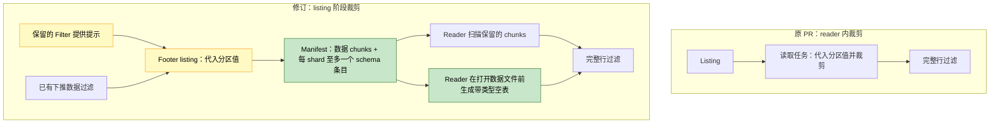

# [Data] 在 Parquet listing 阶段裁剪分区与数据混合过滤条件

在 [#67567](https://github.com/ray-project/ray/issues/67567) 中，`(year == "2023") | (x < 1000)` 会扫描全部 32 个文件的数据，尽管只有五个文件可能贡献结果。最初的 PR 试图在 reader 内避免这些读取。这次按 [Aarrya 的建议](https://github.com/ray-project/ray/pull/67855#issuecomment-6671027378)，把这个决定移到 listing，让读取任务只接收可能匹配的行组。

## 根据评审意见改了什么

谢谢 Aarrya。把处理提前后，我也一起处理了你提出的其他几点。分区替换现在放在通用 helper 中，使用 Ray 已有的列替换 visitor；Parquet 适配器负责核对分区值和文件 schema。已有数据过滤下推也不再禁用这项优化：listing 先应用该过滤，再将剩余行组与代入分区值后选出的行组取交集。原来的下推过滤和完整行过滤都保留。

对 issue 中的查询，`year=2023` 下的文件需要保留全部行组；对其他年份，表达式变成 `x < 1000`，可以通过 footer 排除行组。在下方的类型限制内，这也覆盖了嵌套 AND／OR／NOT、null 检查和长度受限的字面量 IN 列表。

比较棘手的是空结果。删除全部行组后，reader 可能没有任何输入可以用来生成输出 schema。之前尝试过从每个被排除的文件中保留一个行组，但这样仍然要读取谓词已经排除的数据。

这一版增加了 schema-only manifest 条目，用来告诉 reader 生成一个 schema 正确的空表。Listing 对能够核对布局的 shard 至多发出一个这样的条目，与仍需读取的数据 chunks 一起传递。配对 reader 在打开数据文件前，先按正常的分区列处理和投影生成这个空表；即使后面还有数据 chunks，也会这样做，因此也覆盖了直到执行时过滤才返回零行的情况。条目保留真实源文件大小，但 chunk 的读取预算为零；它不代表剩余过滤条件的精确行数。

Aarrya，[#67037](https://github.com/ray-project/ray/pull/67037) 也在调整共享 manifest／count 接口，这种给 reader 的指令适合放在 manifest 中吗？这看起来比修改通用执行器更合适，但在扩展到其他数据源之前，我想先把这个接口讨论清楚。



## 适用范围

目前，新路径处理的是使用内建本地 Hive Parquet 的根 `Filter → ReadFiles → ListFiles` 查询。Float64 可以作为不参与裁剪表达式的数据列，但浮点谓词和算术仍走已有路径。我保留了数据源限制，因为其他文件系统或 scanner 可能以不同方式生成分区值和输出列；共享替换代码并不能保证这些 reader 的行为一致。

<details>
<summary>支持的表达式及回退情况</summary>

| 支持的表达式／类型 | 限制 |
|---|---|
| 有符号 `int8`、`int16`、`int32`、`int64` 比较 | 整数字面量必须在字段位宽范围内。列与列比较必须能通过分区替换变成支持的形式；替换后仍有两个列操作数，就不使用提示。 |
| String／bool 的相等与不等比较、叶节点 null 检查 | 不允许浮点操作数。 |
| 嵌套 AND、OR、NOT | 每个部分都必须受支持，包括多分支 OR。 |
| 字面量 IN 列表 | 1–256 个同类型非 null 值，输入限 int64、bool 或 string。不支持窄整数 IN。 |
| Float64 数据列 | 仅允许作为不参与裁剪表达式的数据列。 |

| 回退到已有路径的情况 | 原因 |
|---|---|
| 浮点谓词／字面量、算术、UDF、窄整数 IN、替换后仍存在的列与列比较 | 当前检查不覆盖其转换和求值行为。本修订不包含 [#67943](https://github.com/ray-project/ray/pull/67943) 的算术边界推导。 |
| 远程／自定义文件系统、scanner／indexer 子类、非 Hive 分区 | 数据源即使读取 Parquet，也可能以不同方式取得分区值。本适配器只核对内建本地 Hive 路径，包括普通重试包装。 |
| Nested／extension 等不支持的类型、schema／field metadata、合成列、自定义 Parquet 格式选项 | Schema-only 空表必须与实际 reader 输出一致，这些布局尚未纳入。 |
| 下游 map、count／limit 计划、保序或 shuffle、checkpoint、允许忽略错误块 | 额外提示仅用于根行查询计划，不保留旧 reader 在 map 下的优化。 |

即使表达式受支持，统计不足时仍可能保留全部行组；IN 的实际裁剪能力也取决于 Arrow 版本。必需的 footer 读取仍会发生，其中以及保留数据中的错误会正常传递。已被排除的行组不会仅为重现页面或表达式错误而读取，因此其中的数据页损坏可能不再报错。

</details>

## 测试

谢谢 [Jadiouo](https://github.com/ray-project/ray/pull/67855#pullrequestreview-5796666582) 同时检查基线和 PR。旧的端到端测试即使读完所有数据也能通过。新的真实 worker 测试除了检查完整输出和 schema，还精确检查实际消费的行组和数据文件，并设置关闭裁剪的对照。计划回归现在放在 listing 规则的测试模块中，位于 main guard 之前。

实测源码与 [eb672700](https://github.com/m4ru1/ray/commit/eb6727009e5305106f45607cffd549e4ca86e512) 一致，基于 `891a5a89`。运行环境为 Linux ARM64、Python 3.11 和匹配的 Ray Core，**设置 `RAY_USAGE_STATS_ENABLED=0`，并禁用测试结果缓存**。这些是本地结果，不代表默认配置或托管 CI 已通过。

| PyArrow | 通过的相关 Bazel 目标 | 通过用例 | 跳过 | 预期失败 |
|---|---:|---:|---:|---:|
| 17.0.0 | 26/26 | 927 | 31 | 1 |
| 23.0.1 | 26/26 | 958 | 0 | 1 |

31 项跳过用例要求 Arrow 20 或更新版本。预期失败对应一种空输入情况：如果分区裁剪在 footer listing 之前移除全部文件，就没有 schema 条目到达 reader。测试也覆盖 listing 之后的空输出、投影、已有下推过滤、重复路径和回退。变更文件的 lint、格式及类型检查通过。Jadiouo 原来的 20 条查询脚本没有作为整组重新运行。

两个端到端检查可以这样运行：

```bash
bazel test --config=ci --nocache_test_results --test_env=RAY_USAGE_STATS_ENABLED=0 \
  //python/ray/data:tests/datasource_v2/test_parquet_mixed_or \
  //python/ray/data:tests/datasource_v2/test_schema_only_manifest
```

## 性能

对 `eb672700`，性能检查测量了实际消费的行组和数据文件，以同一源码关闭裁剪的运行作为对照。在 issue 的 32 文件、每文件五个行组的数据集上，两个 Arrow 版本的结果都是：

| 混合 OR 查询 | 关闭裁剪 | 启用裁剪 |
|---|---:|---:|
| 实际消费的行组 | 160 | 25 |
| 实际消费数据的文件 | 32 | 5 |
| 输出行数 | 5,000 | 5,000 |

完整结果行和 schema 一致，避免消费 27 个文件、135 个行组的数据。Footer 读取仍然发生；这些是数据消费计数，不是总打开次数或字节数。

### 当前修订的同机计时

本修订还与干净的 `891a5a8` 在同一台 Linux x86-64 云主机（16 vCPU、32 GB 内存）上进行了对照，使用匹配的 Core、Python 3.10.12、PyArrow 23.0.1，并关闭 usage statistics。Ray 配置为 8 CPU、4 GiB object store，Data 的 object-store 预算为 2 GiB，禁用 spilling。每个场景按“上游、上游、本修订、本修订、上游”的固定顺序运行，每次启动新的 Ray 实例。查询耗时包含 listing、读取、过滤和流式消费；Ray 启动单独记录，为 2.27–2.30 秒。

| 场景与配对顺序 | 上游查询耗时 | 本修订 | 差异 |
|---|---:|---:|---:|
| 59.75 GB 可裁场景，上游 → 本修订 | 290.25 s | 9.89 s | −96.6% |
| 同一场景，本修订 → 上游 | 249.00 s | 9.30 s | −96.3% |
| 205,457-byte 全保留场景，上游 → 本修订 | 2.122 s | 2.279 s | +157.75 ms（+7.44%） |
| 同一场景，本修订 → 上游 | 2.068 s | 2.235 s | +167.13 ms（+8.08%） |

大数据 fixture 包含 55 个 Hive 分区文件，每个文件有 64 组、每组 16,384 行，每行包含 1,024-byte 字符串 payload。过滤条件 `(p == -1) | (x >= 917504)` 保留每个文件末尾八组。独立的真实 Worker 诊断核对了全部 7,208,960 行的内容和 schema 一致，实际消费从 3,520 组降至 440 组；两臂仍从全部 55 个文件读取数据。小数据场景有 32 个文件、每文件 5 组，保留全部 32,000 行；两臂均消费 160 组，且本修订确实启用了 hint。正式计时移除了完整内容校验和读取观察器。

每个场景只有两对结果，不能作为普遍提速保证。没有清空文件系统缓存：小数据明确预热，大数据计时前先运行了诊断。相邻两次大数据上游计时相差 20.4%（241.08 与 290.25 秒），小数据控制则相差 0.73%。两次大数据候选运行期间设备读取约 1.88 GB 和 11.6 MB，说明缓存贡献明显；这是整机块设备计数，并非精确的数据集读取字节。未观察到 spill。实验支持这个可裁负载的收益，也显示小查询有可测的额外成本；它不能说明冷存储或远程文件系统性能。本轮没有测量 opens。

相关工作：本次实现 #67567 提出的按文件代入，不包含 #67943 的算术／前缀谓词推导或 #67037 的 manifest／count 改动，尚未测试它们组合后的行为。

AI assistance was used.
